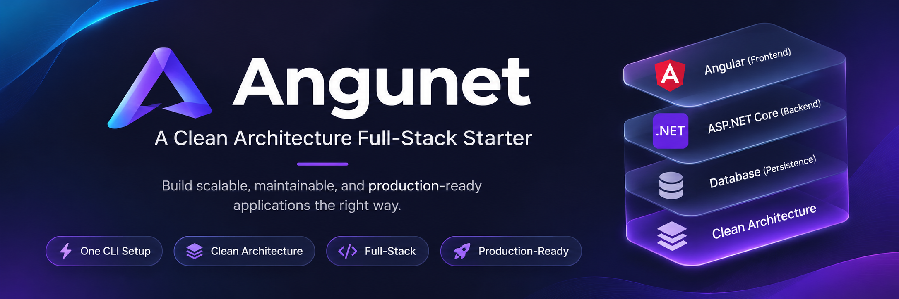

# 🚀 ANGUNET

<div align="center">

  

### A Modern Full-Stack Framework for Angular + .NET

**Build. Run. Scale.**

Production-ready starter framework with **Angular**, **.NET Web API**, **SQL Server/MongoDB**, **Docker**, and **MCP Server** integration.

[](https://www.npmjs.com/package/angunet)
[](LICENSE)
[](https://angular.dev)
[](https://dotnet.microsoft.com/)
[](https://docker.com)

</div>

---

## ✨ Overview

ANGUNET is an **open-source full-stack application framework** designed to help developers bootstrap enterprise-ready applications in minutes.

Instead of spending hours configuring Angular, .NET, Docker, databases, authentication, and project structure, ANGUNET provides a clean, scalable foundation so you can focus on building features.

It includes:

- ⚡ Angular frontend
- 🚀 ASP.NET Core Web API
- 🗄 SQL Server or MongoDB support
- 🐳 Dockerized development environment
- 🤖 MCP Server integration for AI-assisted development
- 📦 CLI for project generation
- 🏗 Clean architecture and scalable folder structure

---

# Features

## 🎯 Full Stack

- Angular UI
- ASP.NET Core API
- SQL Server
- MongoDB
- Docker
- MCP Server

---

## ⚡ Generate a Project in Seconds

```bash
npx angunet my-app
```

ANGUNET generates a production-ready application structure instantly.

---

## 🏗 Generated Angular Structure

```
src/
│
├── core/
│   ├── interceptors/
│   └── layouts/
│
├── data/
│   ├── models/
│   └── services/
│
├── features/
│
└── shared/
    ├── components/
    ├── directives/
    ├── pipes/
    └── validators/
```

Designed for scalability from day one.

---

# What's Included

## Angular UI

- Modern Angular architecture
- Feature-based modules
- Shared components
- HTTP interceptors
- Route layouts
- Environment configuration

---

## .NET API

- ASP.NET Core Web API
- REST API template
- Dependency Injection
- Configuration ready
- Production-friendly structure

---

## Docker

Run the entire stack using Docker.

Includes containers for:

- Angular
- API
- Database
- Supporting services

---

## MCP Server

ANGUNET includes an integrated MCP Server for AI-assisted development workflows.

Included files:

```
mcp-server/
    server.js
    README.md

.mcp.json
```

---

# Environment Configuration

Default development ports:

| Service | Port |
|---------|------|
| Angular | 4200 |
| API | 5260 |
| HTTPS API | 7094 |
| Docker API | 8080 |

---

# Installation

Clone the repository

```bash
git clone https://github.com/<your-username>/angunet.git
```

Install dependencies

```bash
npm install
```

Run Angular

```bash
npm start
```

Run the API

```bash
dotnet run
```

Or launch everything with Docker.

---

# CLI

Create a new project

```bash
npx angunet my-app
```

Additional options

```bash
--no-install
--yes
```

---

# Project Goals

ANGUNET aims to provide:

- Fast project scaffolding
- Clean architecture
- Enterprise-ready structure
- Consistent development experience
- Docker-first workflow
- AI-ready development

---

# Roadmap

- [x] Angular project generator
- [x] .NET API generator
- [x] Docker integration
- [x] MCP Server support
- [x] CLI publishing
- [ ] Authentication templates
- [ ] PostgreSQL support
- [ ] Redis integration
- [ ] Kubernetes deployment
- [ ] CI/CD templates
- [ ] Microservices starter

---

# Contributing

Contributions are welcome!

If you'd like to improve ANGUNET:

1. Fork the repository
2. Create a feature branch
3. Commit your changes
4. Open a Pull Request

Please open an issue before making major changes.

---

# Tech Stack

- Angular
- ASP.NET Core
- TypeScript
- C#
- Docker
- SQL Server
- MongoDB
- Node.js

---

# Why ANGUNET?

✅ Production-ready

✅ Opinionated project structure

✅ Enterprise architecture

✅ Docker-first

✅ AI-ready with MCP

✅ Open Source

---

# License

This project is licensed under the MIT License.

---

<div align="center">

## ⭐ Support the Project

If you find ANGUNET useful, consider giving the repository a **⭐ Star** on GitHub.

It helps others discover the project and motivates future development.

**Build. Run. Scale. 🚀**

</div>
